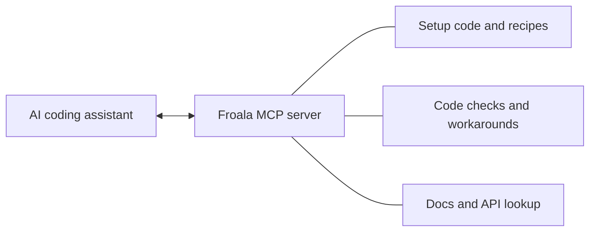

# Froala MCP Server

An MCP server for the [Froala WYSIWYG editor](https://froala.com/wysiwyg-editor/). It gives AI coding assistants setup code for your framework, checks Froala code for mistakes, and searches the official Froala documentation. It makes rich text editing easy to add to an app built with React, Vue, Angular, Next.js, Nuxt or Svelte, or with plain TypeScript.

This is an early version, so please report any bugs you find to support@froala.com. Thanks for helping us!

[](https://cursor.com/en/install-mcp?name=froala&config=eyJ1cmwiOiJodHRwczovL21jcC5mcm9hbGEuY29tL21jcCJ9)
[](https://deploy.workers.cloudflare.com/?url=https://github.com/froala/froala-mcp)

[](https://insiders.vscode.dev/redirect/mcp/install?name=froala&config=%7B%22type%22%3A%22http%22%2C%22url%22%3A%22https%3A%2F%2Fmcp.froala.com%2Fmcp%22%7D)
[](https://insiders.vscode.dev/redirect/mcp/install?name=froala&config=%7B%22type%22%3A%22http%22%2C%22url%22%3A%22https%3A%2F%2Fmcp.froala.com%2Fmcp%22%7D&quality=insiders)
[](https://claude.ai/customize/connectors?modal=add-custom-connector&connectorName=Froala&connectorUrl=https%3A%2F%2Fmcp.froala.com%2Fmcp)
[](https://www.npmjs.com/package/@froala/mcp)
[](https://www.npmjs.com/package/@froala/mcp)
[](LICENSE)
[](https://modelcontextprotocol.io)
[](https://mcplookup.com/server/com.froala/mcp)

## How it works



Your assistant sends your `package.json` and gets setup code that fits your versions of Froala, Vite, Next.js, Nuxt or Angular. After writing the code, it sends the changed files for a check. The server has no account and no API key, and every tool only reads data.

## Connect your AI tool

The hosted server is at `https://mcp.froala.com/mcp`.

| AI tool | How to connect |
|---|---|
| Claude Code | `claude mcp add --transport http froala https://mcp.froala.com/mcp` |
| Claude (web and desktop) | Click **Add to Claude** above |
| Cursor | Click **Add to Cursor** above |
| VS Code | Click **Install in VS Code** above |
| Codex | `codex mcp add froala --url https://mcp.froala.com/mcp` |
| Gemini CLI | `gemini mcp add --transport http froala https://mcp.froala.com/mcp` |
| Windsurf and others | Add the URL as a Streamable HTTP server (Windsurf calls the field `serverUrl`) |

To run it on your own machine instead, use the npm package with Node.js 20 or newer. For example, run `claude mcp add froala -- npx -y @froala/mcp`, or add this to a JSON config.

```json
{
  "mcpServers": {
    "froala": { "command": "npx", "args": ["-y", "@froala/mcp"] }
  }
}
```

## Try Froala for free

- On localhost, Froala works fully without a key and without signing up.
- On any other domain without a key, such as a preview deployment, it shows an unlicensed banner and only bold, italic and underline work.
- For a real domain, get a free 30-day [trial key](https://froala.com/get-trial-key/), and buy a [licence](https://froala.com/wysiwyg-editor/pricing/) before you ship. `froala_licensing` shows where the key goes.

## Tools

| Tool | What it does | Main inputs |
|---|---|---|
| `froala_get_setup` | Install command and files for your framework and versions | `framework`, `package_json` |
| `froala_recipes` | Ready-made settings for comments, chat, email, documents and more | `use_case` |
| `froala_check_code` | Finds common mistakes, with a fix for each | `files`, including `package.json` |
| `froala_workarounds` | Fixes for known problems with your versions | `package_json` |
| `froala_lookup` | Options, plugins, toolbar buttons, events and methods | `kind`, `name` or `names` |
| `froala_search_docs` | Searches the Froala docs and examples | `query` |
| `froala_get_page` | Returns a docs page or one section of it | `url` |
| `froala_licensing` | The free trial and where the licence key goes | none |

`froala_check_code` reports errors (confirmed problems), warnings (likely problems to confirm) and tips (optional). The two prompts, `add-froala` and `review-froala`, walk an assistant through adding Froala to a project and reviewing existing Froala code.

## Limits and privacy

- The hosted server allows 120 tool calls a minute per IP address, then replies with HTTP 429 and `Retry-After`.
- `froala_check_code` takes up to 20 files and 200,000 characters, and returns up to 60 findings.
- Answers are at most 25,000 characters.
- The hosted server logs the tool name, the HTTP status, the time taken, the country and the client's name. It never logs the code or questions you send.
- The local version has the same limits on input and answers, but no rate limit and no logging.

## Known limitations

- The data comes from one Froala release (5.5.0) and a docs snapshot (12 October 2026). Answers say so when your project uses a newer Froala.
- The checks look for common Froala mistakes. They don't replace building and running your app.
- Settings defined in a file you didn't send are listed as not checked.

## Troubleshooting

- **The assistant doesn't use the tools.** Check that the server lists 8 tools in your AI tool, then ask it to "use the Froala MCP".
- **HTTP 429.** Wait a minute. `froala_lookup` takes several names at once, which saves calls.
- **Which version is running?** Open `https://mcp.froala.com/health`.

## Run your own copy

Click **Deploy to Cloudflare Workers** above, or deploy it yourself.

```bash
git clone https://github.com/froala/froala-mcp.git
cd froala-mcp
npm install
npx wrangler deploy
```

The rate limit is set in `wrangler.jsonc`. To let web pages call your server from a browser, list their origins in the `ALLOWED_ORIGINS` variable.

## Development

```bash
npm install
npm test             # unit tests
npm run build        # build dist/stdio.js for the npm package
npm run smoke        # call every tool through the local version
npm run dev          # run the hosted version at http://localhost:8787/mcp
npm run build:data   # rebuild the Froala data for a new release
```

`node scripts/call.mjs <tool> name=value` calls one tool from the command line, and `eval/` checks the setup code in fresh apps (see [docs/EVALUATION.md](docs/EVALUATION.md)).

```text
src/
  server.ts        the list of tools
  project.ts       reads package.json, and known problems that depend on versions
  tools/           one file per tool
  templates/       setup code for each framework
  check/           how froala_check_code reads code, and its checks
  worker.ts        hosted version (Cloudflare Workers)
  stdio.ts         local version (npx @froala/mcp)
content/           licensing text
data/              Froala metadata and docs, built by scripts/
docs/              specification, research, evaluation and audit response
```

To remove a tool, such as the workarounds once a Froala release fixes them, delete its line in `src/server.ts`.

## Bugs, security and license

Please report bugs to support@froala.com, and security problems as described in [SECURITY.md](SECURITY.md).

This server is MIT licensed (see [LICENSE](LICENSE)). The Froala editor itself has its own [licence terms](https://froala.com/wysiwyg-editor/terms/).
