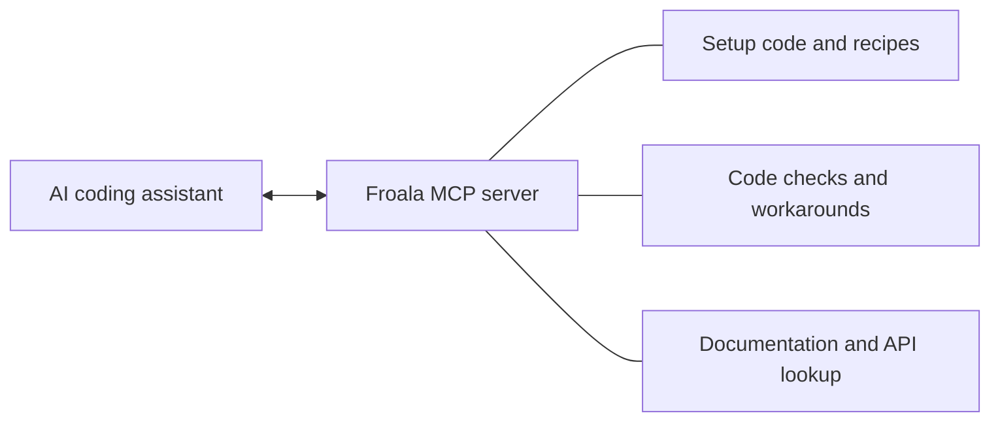

# Froala Rich Text Editor - MCP Server

An MCP server for the [Froala WYSIWYG editor](https://froala.com/wysiwyg-editor/). It provides AI coding assistants with setup code for your framework, checks Froala code for common mistakes, and searches the official Froala documentation. It simplifies adding rich text editing to applications built with React, Vue, Angular, Next.js, Nuxt or Svelte, or with plain TypeScript.

This is an early release. Please report any issues to support@froala.com. Thank you for your help.

[](https://deploy.workers.cloudflare.com/?url=https://github.com/froala/froala-mcp)
[](https://cursor.com/en/install-mcp?name=froala&config=eyJ1cmwiOiJodHRwczovL21jcC5mcm9hbGEuY29tL21jcCJ9)

[](https://insiders.vscode.dev/redirect/mcp/install?name=froala&config=%7B%22type%22%3A%22http%22%2C%22url%22%3A%22https%3A%2F%2Fmcp.froala.com%2Fmcp%22%7D)
[](https://insiders.vscode.dev/redirect/mcp/install?name=froala&config=%7B%22type%22%3A%22http%22%2C%22url%22%3A%22https%3A%2F%2Fmcp.froala.com%2Fmcp%22%7D&quality=insiders)
[](https://claude.ai/customize/connectors?modal=add-custom-connector&connectorName=Froala&connectorUrl=https%3A%2F%2Fmcp.froala.com%2Fmcp)
[](https://modelcontextprotocol.io)

> [!TIP]
> The hosted server is available at **`https://mcp.froala.com/mcp`**. Add this URL to any AI tool that supports remote MCP servers, or use one of the buttons above.

## How it works



The assistant sends the project's `package.json` and receives setup code that matches the installed versions of Froala, Vite, Next.js, Nuxt or Angular. After writing the code, it sends the changed files to be checked. The server requires no account or API key, and every tool is read-only.

## Run the server locally

To run the server on your own machine instead of using the hosted server, use the npm package, which requires Node.js 20 or newer. For example, run `claude mcp add froala -- npx -y @froala/mcp`, or add the following to a JSON configuration file.

```json
{
  "mcpServers": {
    "froala": { "command": "npx", "args": ["-y", "@froala/mcp"] }
  }
}
```

## Try Froala for free

- On localhost, Froala works fully without a license key or registration.
- On any other domain without a key, including preview deployments, the editor displays an unlicensed banner and only bold, italic and underline are available.
- To evaluate Froala on a public domain, request a free 30-day [trial key](https://froala.com/get-trial-key/). A [license](https://froala.com/wysiwyg-editor/pricing/) is required before going to production. The `froala_licensing` tool explains where the key belongs in each framework.

## Tools

| Tool | Purpose | Main inputs |
|---|---|---|
| `froala_get_setup` | Returns the install command and files for your framework and versions | `framework`, `package_json` |
| `froala_recipes` | Returns ready-made settings for comments, chat, email, documents and other uses | `use_case` |
| `froala_check_code` | Detects common mistakes and suggests a fix for each | `files`, including `package.json` |
| `froala_workarounds` | Lists fixes for known problems with your versions | `package_json` |
| `froala_lookup` | Describes options, plugins, toolbar buttons, events and methods | `kind`, `name` or `names` |
| `froala_search_docs` | Searches the Froala documentation and examples | `query` |
| `froala_get_page` | Returns a documentation page or one of its sections | `url` |
| `froala_licensing` | Explains the free trial and where the license key belongs | none |

`froala_check_code` reports errors (confirmed problems), warnings (likely problems that should be confirmed) and tips (optional improvements). Two prompts are also available. `add-froala` guides an assistant through adding Froala to a project, and `review-froala` guides it through reviewing existing Froala code.

## Limits and privacy

- The hosted server accepts 120 tool calls per minute from each IP address. Beyond that, it responds with HTTP 429 and a `Retry-After` header.
- `froala_check_code` accepts up to 20 files and 200,000 characters, and returns up to 60 findings.
- Each answer is limited to 25,000 characters.
- The hosted server records the tool name, the HTTP status, the response time, the country and the client name. It never records the code or questions that you send.
- The local version applies the same limits to input and answers, without the rate limit or any logging.

## Troubleshooting

- **The assistant does not use the Froala tools.** Confirm that your AI tool shows the Froala server as connected, with 8 tools available. If it does, mention the server in your request, for example "Add a Froala editor to this page using the Froala MCP server".
- **Requests fail with HTTP 429.** The limit of 120 tool calls per minute has been reached. Wait one minute before trying again. To reduce the number of calls, look up several items in one `froala_lookup` call by using its `names` input.
- **Checking the server version.** The `https://mcp.froala.com/health` endpoint returns the server version and the Froala release that its data covers.

## Run your own copy

Use the **Deploy to Cloudflare** button above, or deploy the server manually.

```bash
git clone https://github.com/froala/froala-mcp.git
cd froala-mcp
npm install
npx wrangler deploy
```

The rate limit is configured in `wrangler.jsonc`. To allow web pages to call the server from a browser, list their origins in the `ALLOWED_ORIGINS` variable.

## Development

```bash
npm install
npm test             # run the unit tests
npm run build        # build dist/stdio.js for the npm package
npm run smoke        # call every tool through the local version
npm run dev          # run the hosted version at http://localhost:8787/mcp
npm run build:data   # rebuild the Froala data for a new release
```

`node scripts/call.mjs <tool> name=value` calls a single tool from the command line. The `eval/` folder contains scripts that test the setup code in new applications, described in [docs/EVALUATION.md](docs/EVALUATION.md).

```text
src/
  server.ts        the list of tools
  project.ts       reads package.json, and known problems that depend on versions
  tools/           one file per tool
  templates/       setup code for each framework
  check/           how froala_check_code reads code, and its checks
  worker.ts        hosted version (Cloudflare Workers)
  stdio.ts         local version (npx @froala/mcp)
content/           licensing text
data/              Froala metadata and documentation, built by scripts/
docs/              specification, research, evaluation and audit response
```

To remove a tool, for example the workarounds once a Froala release resolves them, delete its line in `src/server.ts`.

## Bugs, security and license

Please report bugs to support@froala.com, and security issues as described in [SECURITY.md](SECURITY.md).

The Froala MCP server, like the Froala editor, is subject to the Froala [license terms](https://froala.com/wysiwyg-editor/terms/). See [LICENSE](LICENSE).
